# Herdline

Offline-first dairy herd management for farm teams. Register animals, follow pedigrees, record
daily milk, track lactations, breeding and bull semen stock, keep health records with milk
withdrawal periods, and read the key numbers on a dashboard and reports. Everything is stored in
a local SQLite database on the phone, so it works in a barn with no signal.

## Demo

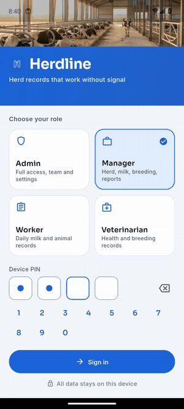

Captured on an Android emulator. The same codebase builds for iOS.
The walkthrough covers sign-in, dashboard, herd, an animal profile, pedigree, milk and record milk;
breeding and reports are in the screenshots below.

## Screens

| Sign in | Dashboard | Herd | Animal profile |
|---|---|---|---|
| 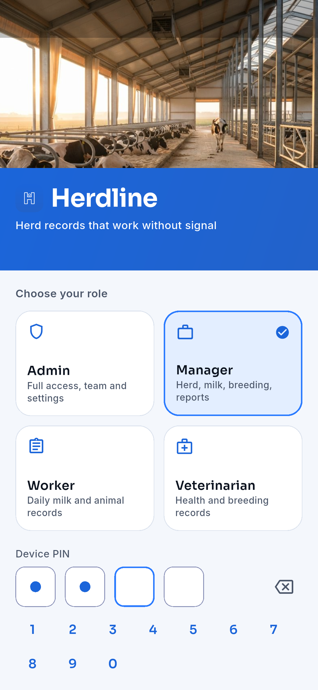 | 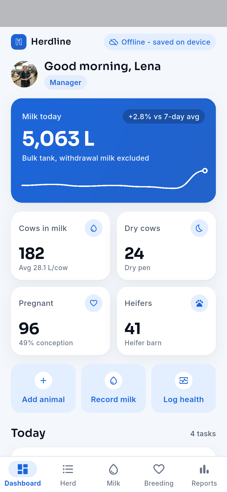 | 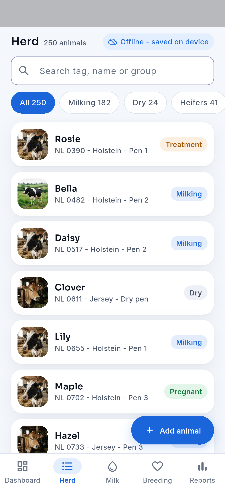 | 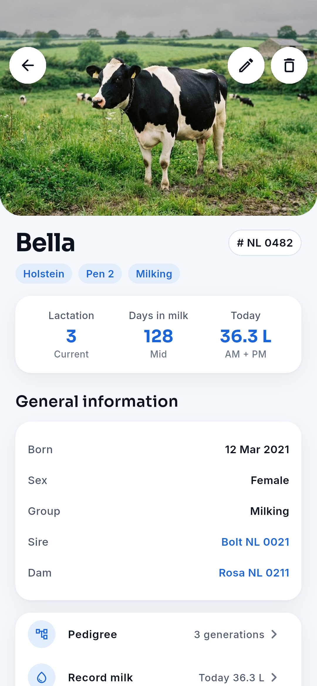 |

| Pedigree | Lactation | Milk | Record milk |
|---|---|---|---|
| 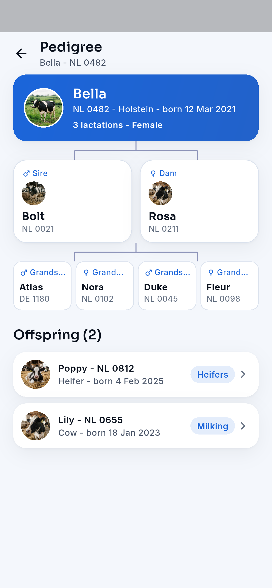 | 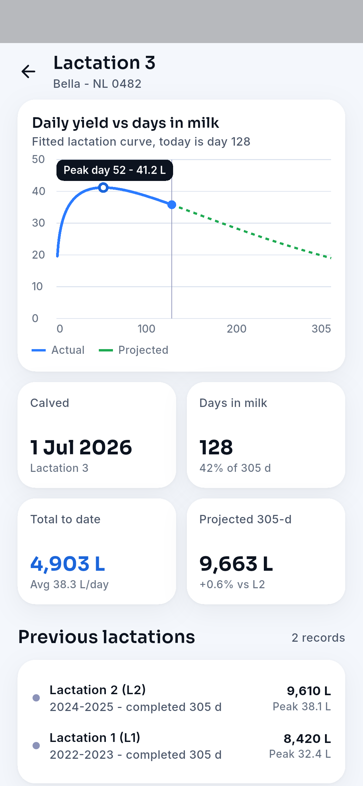 | 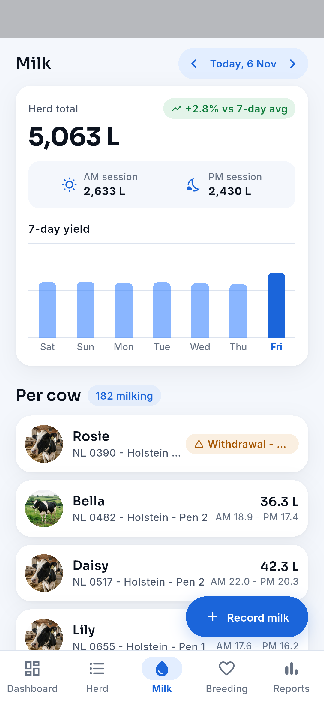 | 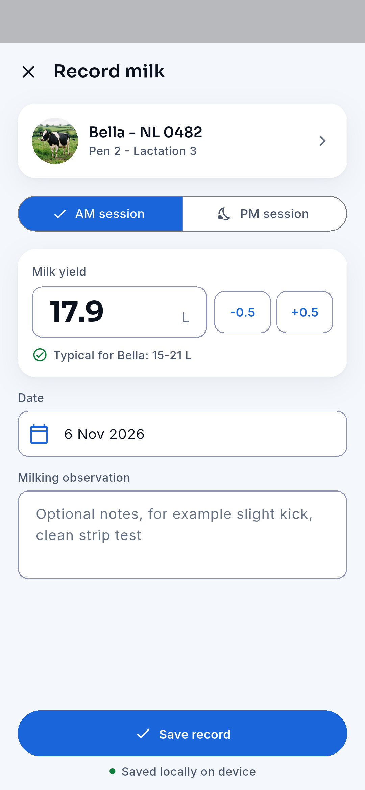 |

| Breeding | Bulls and semen | Health records | Reports |
|---|---|---|---|
| 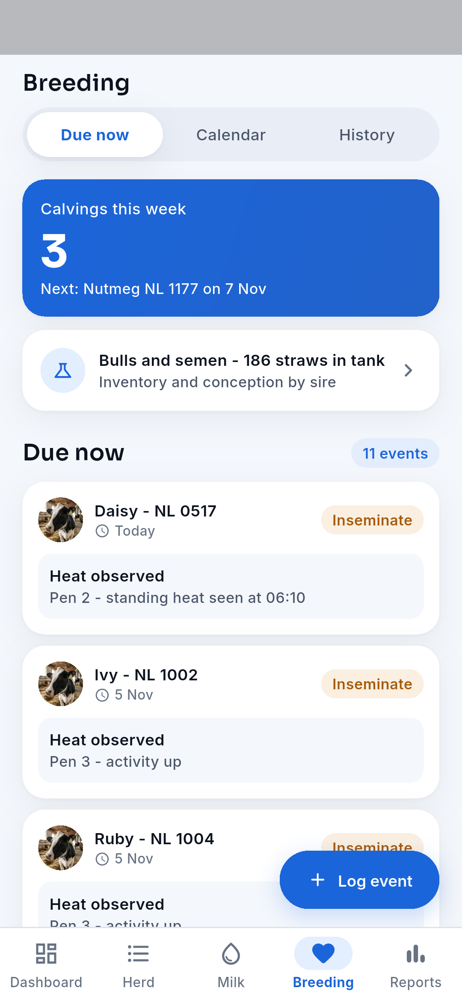 | 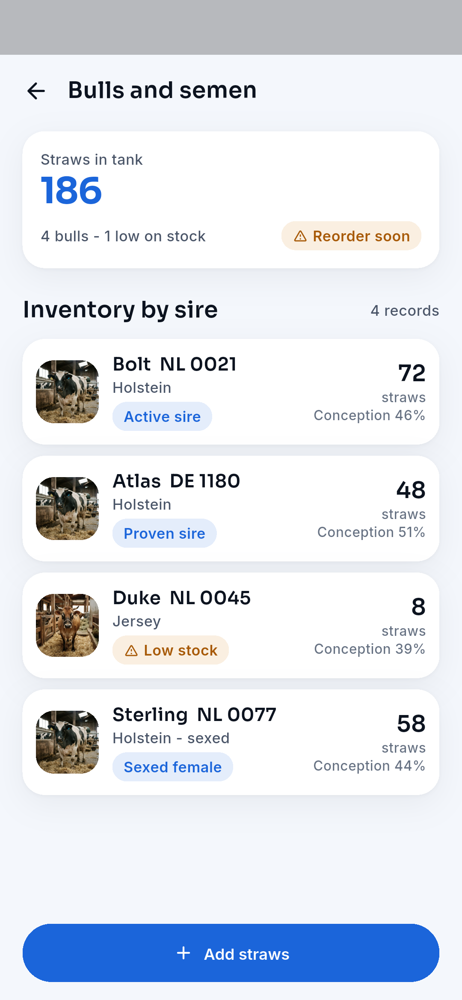 | 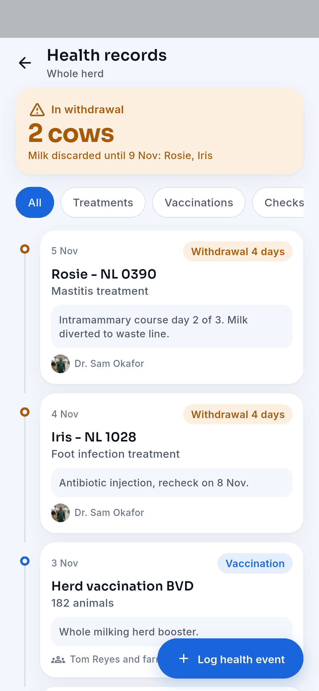 | 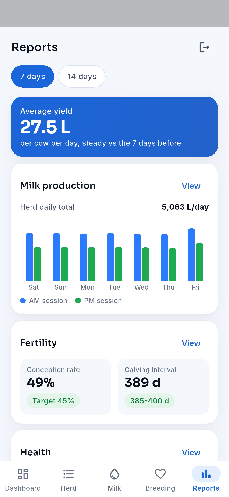 |

## What it shows

- **Animal registration and profiles**: create, view, edit and delete animals (ear tag, name,
  breed, sex, birth date, group, pen, sire and dam). The form validates the tag format, blocks a
  duplicate tag and requires a name and birth date.
- **Pedigree**: three generations (animal, parents, grandparents) plus offspring, all linked.
- **Daily milk records**: AM and PM sessions per cow, herd total, 7-day chart, previous days.
  Milk from cows in a withdrawal period is recorded but kept out of the tank total.
- **Lactation management**: a fitted lactation curve per cow (peak day and yield, days in milk),
  yield to date, 305-day projection, closed lactations, and dry-off.
- **Breeding and reproduction**: heats, inseminations (each uses one straw from the tank),
  pregnancy checks (update the cow's status) and calving due dates, with due-now, calendar and
  history views.
- **Bulls and semen**: straw inventory per sire, conception rate, low-stock warning, add straws.
- **Health records**: treatments, vaccinations and checks on a timeline, with milk withdrawal.
- **Dashboard and reports**: milk today vs the 7-day average, herd structure, conception rate,
  calving interval, treatments, AM/PM production.
- **Roles**: Admin, Manager, Worker and Veterinarian. Every role can read the herd; what each role
  may change is set in one permission table (Workers record animals and milk, Vets record health
  and breeding, only Admins manage the team).
- **Sample farm**: 250 head with 14 days of milk records, breeding and health history, generated
  from a fixed seed on first launch so the demo is the same every time.

## Flow

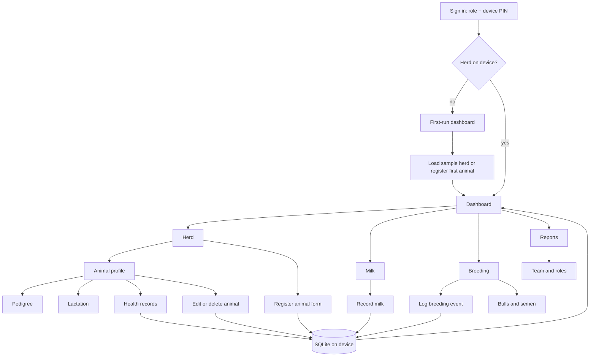

## Architecture

```
lib/
  domain/    models, permissions, HerdView (pure queries: totals, lactation, fertility)
  data/      HerdRepository interface, SQLite (sqflite) and in-memory implementations, sample farm
  state/     Riverpod 3 notifiers: session (role) and herd (AsyncNotifier over the repository)
  core/      design tokens, shared widgets, chart painters
  features/  auth, dashboard, herd, milk, breeding, health, reports, shell
```

- Screens read from Riverpod providers only; every write goes to SQLite first, then the state is
  reloaded, so the UI always shows what is stored.
- `HerdView` holds the farm logic (withdrawal exclusion, Wood's lactation curve, conception rate,
  calving interval) without Flutter imports, so it is unit tested directly.
- Firebase, cloud backup, push and multi-device sync are left for a later phase: the repository
  interface is the seam where a sync layer would plug in.

## Run

```sh
flutter pub get
flutter run            # Android or iOS device / emulator
flutter test           # unit + widget tests
```

Flutter 3.35, Dart 3.9. Design source: `design/` (screens, design system, image assets).
